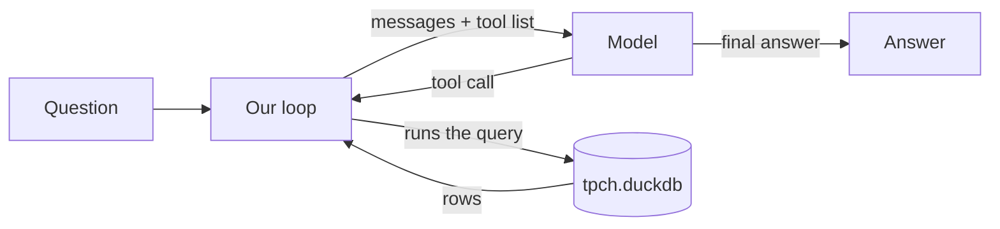

# m01: The agent loop

## Why this exists
A model can only write text. It can't open a database. An agent is ordinary code that lets the
model ask for an action, runs it, and hands back the result until the job is done.

## The picture


## Walkthrough
`agent.py` has five marked steps: ask the model, stop if it didn't ask for a tool, run the tool,
hand the result back, and give up when the step budget runs out. It also has a total time limit,
and it reports a model outage instead of crashing. Each run returns a `Result` with a status.

`tools.py` holds the one tool. It accepts a single SELECT, can't read local files, stops slow
queries, and flags results it had to cut. Every run is saved to `logs/`.

## Run it
```bash
python m01_agent_loop/agent.py "Which nation has the most customers?"
pytest -q tests/test_m01*.py
```
You'll see `[step n]` lines for each query, then a one-sentence answer. This needs a model
running and a `.env` copied from `.env.example`. The tests need neither.

## Break it
`python m01_agent_loop/break_it.py` plays a model that never stops. Three steps, then the budget ends it.

## Exercise
Add a second tool, `list_tables`, and watch the model pick between the two.
